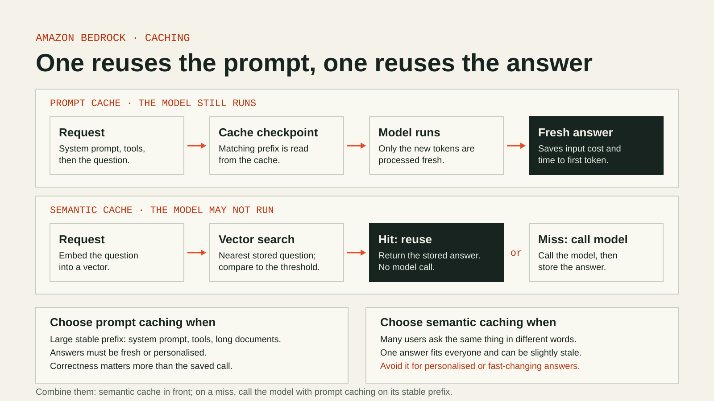

# Caching

Bedrock prompt caching reuses a large, static prompt prefix across requests. It is not a response cache: the model still runs on every request and writes a fresh answer. That makes it the right fit when many requests share instructions and tools but each carries unique data.



## Which cache fits

| Pattern | What is reused | Fits when | Does not fit when |
|---|---|---|---|
| Prompt caching (Bedrock) | The processed prompt prefix: tools, system instructions, long documents | Many requests share a large static prefix and need their own answer | The prefix changes on every request |
| Deterministic response cache | A stored answer for an identical request | Identical requests repeat, and one answer fits all callers | Every request carries unique data |
| Semantic cache | A stored answer for a similar request | Many users ask the same thing in different words | Answers must be isolated per request or per user |

**Worked scenario:** every request carries the same tool definitions and safety instructions, plus a unique sensor report, and answers must stay strictly isolated.
- Use prompt caching, with a `cachePoint` on the reusable prefix.
- A response cache never hits, because no two reports are identical.
- A semantic cache could return another report's answer, which breaks isolation.

## Put the checkpoint after the reusable prefix

Bedrock processes the request in the order `tools`, then `system`, then `messages`. Put the static parts first, add a `cachePoint` after them, and put the unique data after the last checkpoint.

```json
{
  "modelId": "MODEL_ID",
  "toolConfig": {
    "tools": [
      {"toolSpec": {"name": "lookup_asset", "description": "Look up a sensor asset by ID.",
                    "inputSchema": {"json": {"type": "object", "properties": {"asset_id": {"type": "string"}},
                                             "required": ["asset_id"]}}}},
      {"cachePoint": {"type": "default"}}
    ]
  },
  "system": [
    {"text": "Safety instructions shared by every request..."},
    {"cachePoint": {"type": "default"}}
  ],
  "messages": [
    {"role": "user", "content": [{"text": "Sensor report 7731: pressure 4.2 bar, valve B stuck..."}]}
  ]
}
```

The tests validate this request against the installed Converse API model. The prefix before a checkpoint must reach the model's minimum token count, so in real use the tools and instructions are long.

## Rules

| Topic | What AWS documents |
|---|---|
| Support | Varies by model and API. Explicit checkpoints work only on the models listed in the documentation table. |
| Where | `cachePoint` in `tools`, `system` or `messages`, in any combination. In `InvokeModel`, Claude uses `cache_control` on content blocks, and Nova uses `cachePoint`. |
| Minimum size | 512 to 4,096 tokens per checkpoint, depending on the model, counted over the whole prefix. Below the minimum the request still succeeds but nothing is cached. |
| Checkpoints | Up to 4 per request for the Claude and Nova models listed |
| TTL | 5 minutes by default, and reset on each hit. Models that list it accept `"ttl": "1h"`. Sending `ttl` to a 5-minute-only model can raise a `ValidationException`. A 1-hour entry must come before 5-minute entries. |
| Changes | Changing the prefix causes cache misses, and changing `tools` invalidates the `system` and `messages` caches after it |
| Scope | On-demand inference only; not batch inference |
| Price | Cache writes are billed at the model's cache-write rate, which can be higher than the standard input rate. Cache reads are billed at the cache-read rate. |

Claude models also support simplified cache management: one top-level `cache_control` field, passed through `additionalModelRequestFields` in Converse, lets the model place and move the checkpoint itself.

## Check that it hit

Bedrock does not guarantee a cache hit. An eligible request can still write a new entry, for example when it is served by another server or Region, or sent before an identical request finishes. Cross-Region inference can increase cache writes. So read the usage fields on every response:

| Field | Meaning |
|---|---|
| `cacheReadInputTokens` | Tokens read from the cache: a hit |
| `cacheWriteInputTokens` | Tokens written to the cache: a miss that created an entry |
| `cacheDetails` | The TTL used for the tokens written |
| `inputTokens` | Only the non-cached input tokens |

Total input tokens = `inputTokens` + `cacheReadInputTokens` + `cacheWriteInputTokens`. A cost dashboard that sums only `inputTokens` undercounts. CloudWatch also publishes `CacheReadInputTokenCount` and `CacheWriteInputTokenCount`; see [Monitoring and logging](monitoring-and-logging.md).

## Go deeper

- Slides: [Cache at three layers](../decks/04-agent-cost-models-tokens.md#cache-at-three-layers), [One reuses the prompt, one the answer](../decks/04-agent-cost-models-tokens.md#one-reuses-the-prompt-one-the-answer), [Caches need invalidation and alarms](../decks/04-agent-cost-models-tokens.md#caches-need-invalidation-and-alarms)
- Related: [Cost and quota](cost-and-quota.md)

Source: [Prompt caching for faster model inference](https://docs.aws.amazon.com/bedrock/latest/userguide/prompt-caching.html).
