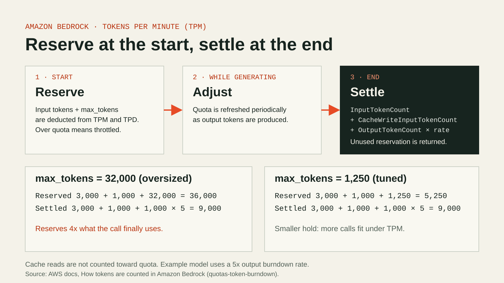

# Cost and quota

Model calls dominate the bill, and every input token is paid on every call. Quota is counted in tokens per minute, and the reservation is taken before the model answers.

## Quota

A request reserves its input tokens plus `max_tokens` at the start, so an oversized `max_tokens` throttles you even when answers are short. See the [`max_tokens` gotcha](../gotchas.md#max_tokens-reserves-quota).

## Cutting the spend

- **Cache the static prefix:** use prompt caching for tools and instructions shared across requests. See [Caching](caching.md).
- **Pick the cheapest capable model:** classify the task first, then escalate only on doubt.
- **Bound agent loops:** cost grows in the loop, not in the prompt.

## Attributing spend

Application inference profiles let you attribute usage and cost per assistant or tenant. `requestMetadata` tags appear in invocation logs but are not cost allocation tags; see [Monitoring and logging](monitoring-and-logging.md#tag-every-call). With caching on, count input as `inputTokens` plus cache reads plus cache writes.

## Go deeper

- Slides: [Every prompt token is paid on every call](../decks/04-agent-cost-models-tokens.md#every-prompt-token-is-paid-on-every-call), [Classify the task, then pick the tier](../decks/04-agent-cost-models-tokens.md#classify-the-task-then-pick-the-tier), [Escalate on doubt, not by default](../decks/04-agent-cost-models-tokens.md#escalate-on-doubt-not-by-default), [Cost grows in the loop, not the prompt](../decks/03-agent-cost-reasoning.md#cost-grows-in-the-loop-not-the-prompt), [Attribute spend to something](../decks/10-observability-and-performance.md#attribute-spend-to-something)
