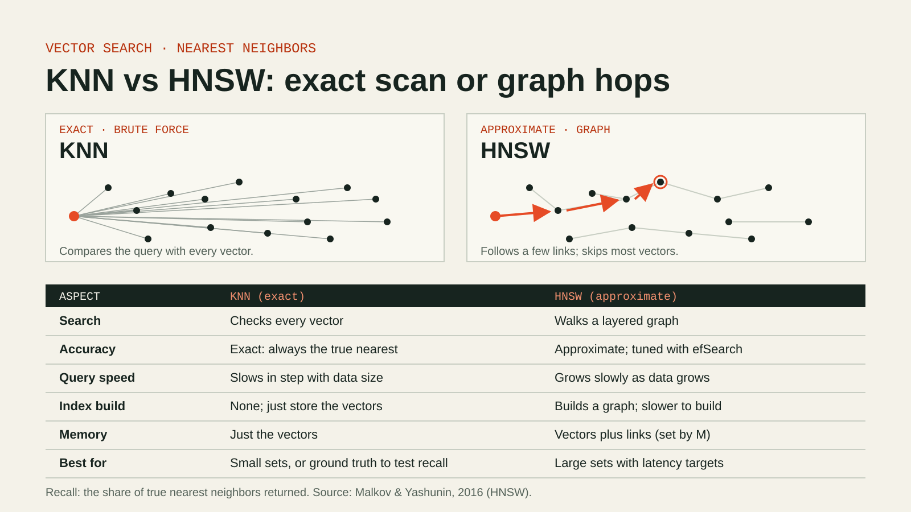

# Knowledge Bases

A Bedrock Knowledge Base ingests documents, splits them into chunks, embeds them, and stores the vectors so the application can retrieve relevant passages.

## Two calls

| API | What it does | Use it when |
|---|---|---|
| `Retrieve` | Vector (or hybrid) search only. Returns chunks with relevance scores and runs no model. | You build the prompt yourself and want the raw chunks |
| `RetrieveAndGenerate` | Retrieves, prompts a model with the chunks, and returns an answer with citations | You want retrieval, generation and citations in one call |

## Search settings

Set under `retrievalConfiguration.vectorSearchConfiguration`, for customer-managed (vector store) knowledge bases.

| Setting | What it does | Watch for |
|---|---|---|
| `overrideSearchType: HYBRID` | Queries both the vector embeddings and the raw text. Good for natural-language questions that contain exact identifiers. | Only supported for Amazon RDS, OpenSearch Serverless and MongoDB vector stores that contain a filterable text field. Otherwise the query silently uses semantic search. |
| `overrideSearchType: SEMANTIC` | Queries the vector embeddings only | An exact identifier can be outranked by text that only sounds similar |
| `rerankingConfiguration` | A reranker model re-scores the retrieved passages, and its order overrides the default ranking | Text only. Amazon Rerank 1.0 or Cohere Rerank 3.5; Amazon Rerank 1.0 is not available in US East (N. Virginia). It cannot add passages that were never retrieved. |
| `filter` | Metadata filter that limits which chunks are eligible | Only works on attributes ingested from the metadata files |

If the application must keep using the Knowledge Bases API, HYBRID plus a reranker is the lower-code fit. Calling OpenSearch Serverless directly is an option only when you are not tied to that API.

## Chunking

How documents are split decides what retrieval can return. See [Chunking configuration](chunking-configuration.md) for the API fields, ranges and how to choose a strategy.

## Vector search

More in [Diagrams](../diagrams.md#hnsw-search).

## Go deeper

- Slides: [Match the store to the workload](../decks/08-data-to-retrieval.md#match-the-store-to-the-workload), [Metadata makes retrieval precise](../decks/08-data-to-retrieval.md#metadata-makes-retrieval-precise), [Transform, retrieve, rerank](../decks/08-data-to-retrieval.md#transform-retrieve-rerank), [Hybrid finds the ID. Rerank fixes the order.](../decks/08-data-to-retrieval.md#hybrid-finds-the-id-rerank-fixes-the-order), [Sync the index when sources change](../decks/08-data-to-retrieval.md#sync-the-index-when-sources-change)
- Troubleshooting: [Debug retrieval before the prompt](../decks/11-evaluate-and-troubleshoot.md#debug-retrieval-before-the-prompt)
- Lab: the Knowledge Base Lab and the Chunking Playground in [Labs and setup](../labs.md)

Sources: [Configure and test knowledge base retrieval](https://docs.aws.amazon.com/bedrock/latest/userguide/kb-test-config.html), [Rerank models](https://docs.aws.amazon.com/bedrock/latest/userguide/rerank.html).
