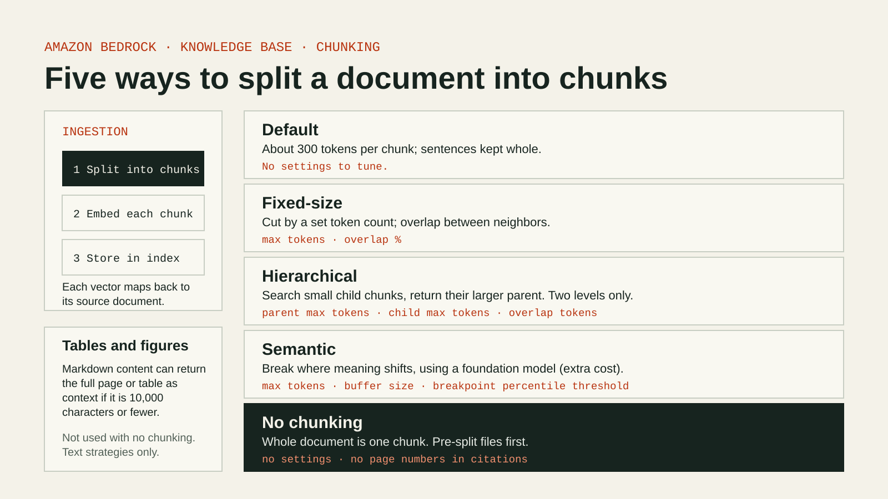
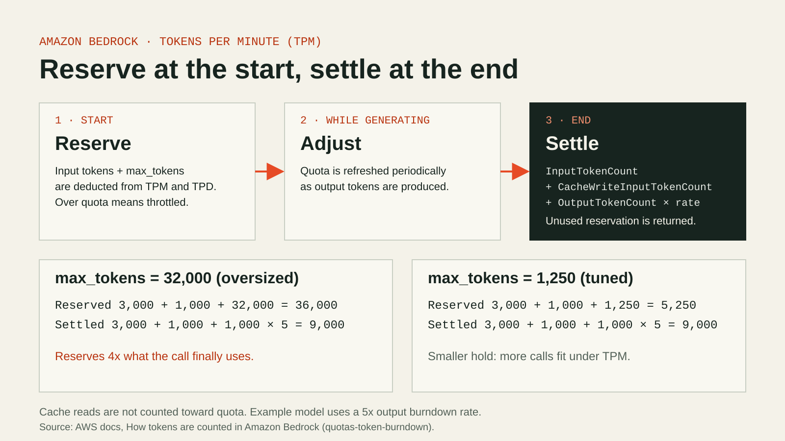
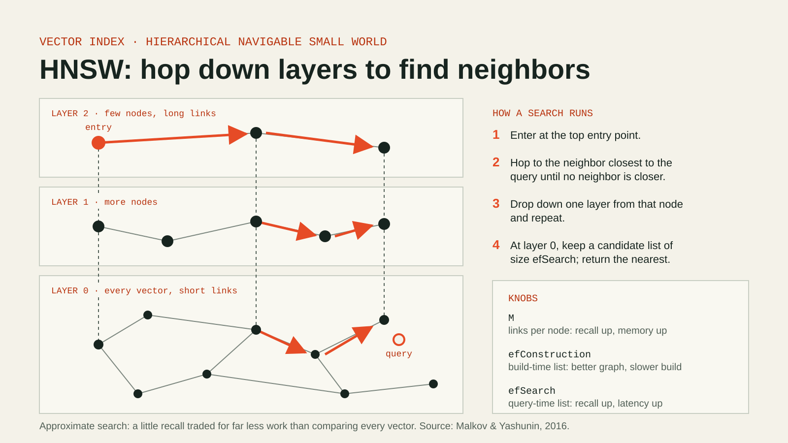
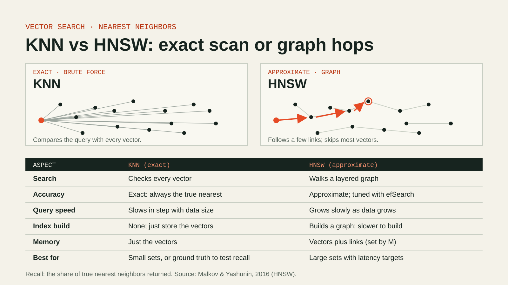
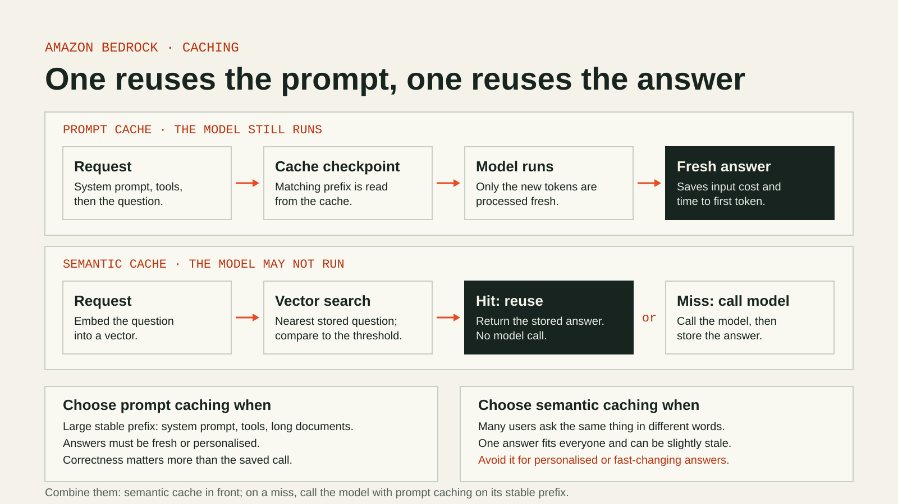

# Diagrams

Click a diagram to zoom. Each one has a full text description for screen readers in the SVG itself.

## Chunking strategies

Default, fixed-size, hierarchical, semantic, and no chunking, with the settings each one takes. For the API fields, ranges and how to choose, see [Chunking configuration](bedrock/chunking-configuration.md).

## Token quota burndown

How a request is reserved against the tokens-per-minute quota and settled afterwards. See also the [`max_tokens` gotcha](gotchas.md).

## HNSW search

The layered graph an HNSW index walks, from sparse upper layers down to the dense bottom layer.

## KNN versus HNSW

Exact nearest-neighbor search compared with the approximate graph search.

## Prompt caching versus semantic caching

Prompt caching reuses the processed prefix and still runs the model. Semantic caching reuses a stored answer and may skip the model. The slide for this is in [deck 04](slides/04-agent-cost-models-tokens/index.html).
