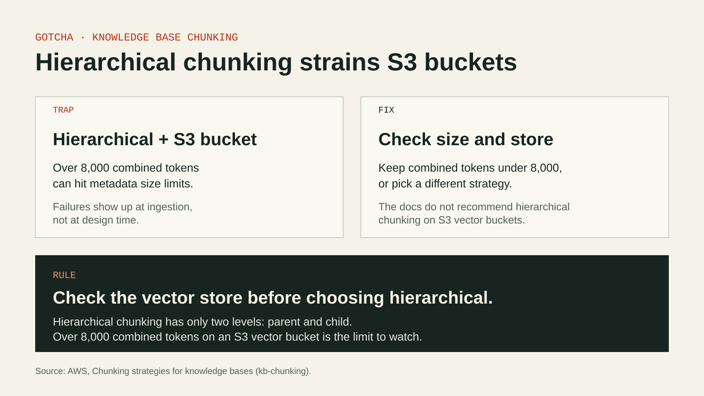
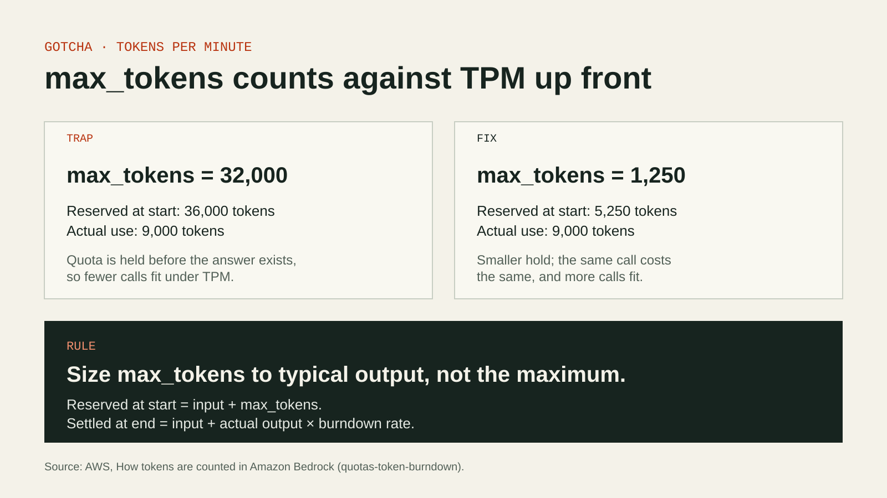
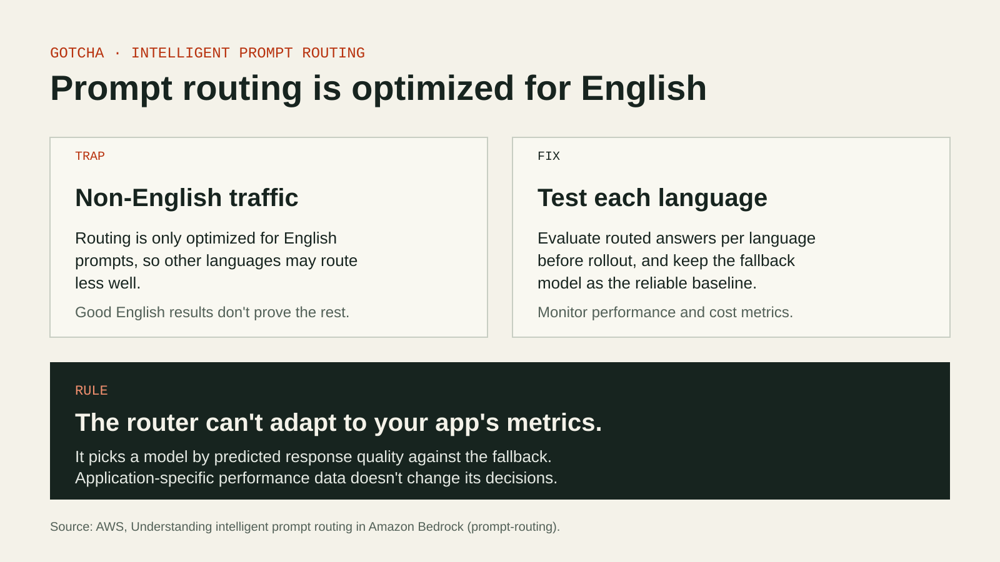
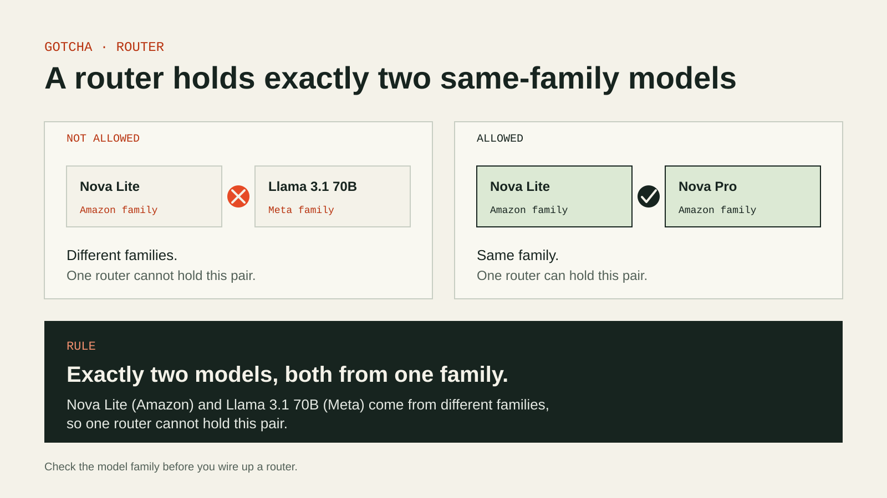

# Gotchas

Four details that are easy to get wrong. Each card states the trap, the fix, and the rule to remember.

## Hierarchical chunking on S3 vector buckets

See [Chunking configuration](bedrock/chunking-configuration.md) for the hierarchical fields.

## `max_tokens` reserves quota

See the [token quota burndown diagram](diagrams.md#token-quota-burndown).

## Prompt routing is English-only

## A router needs two models from one family

